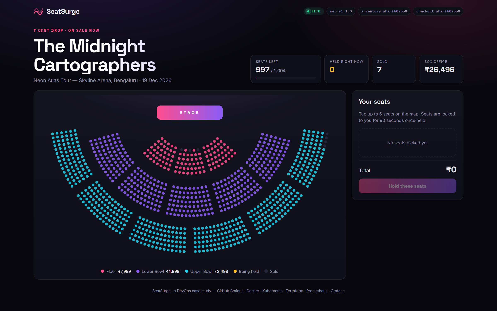
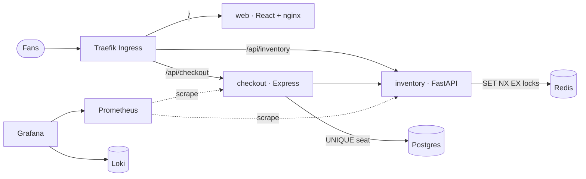
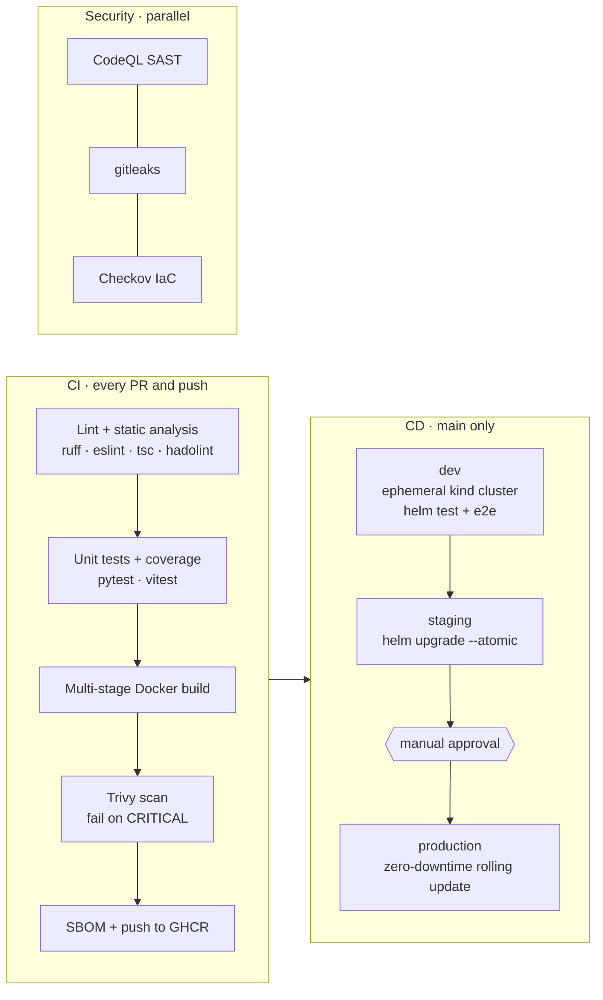
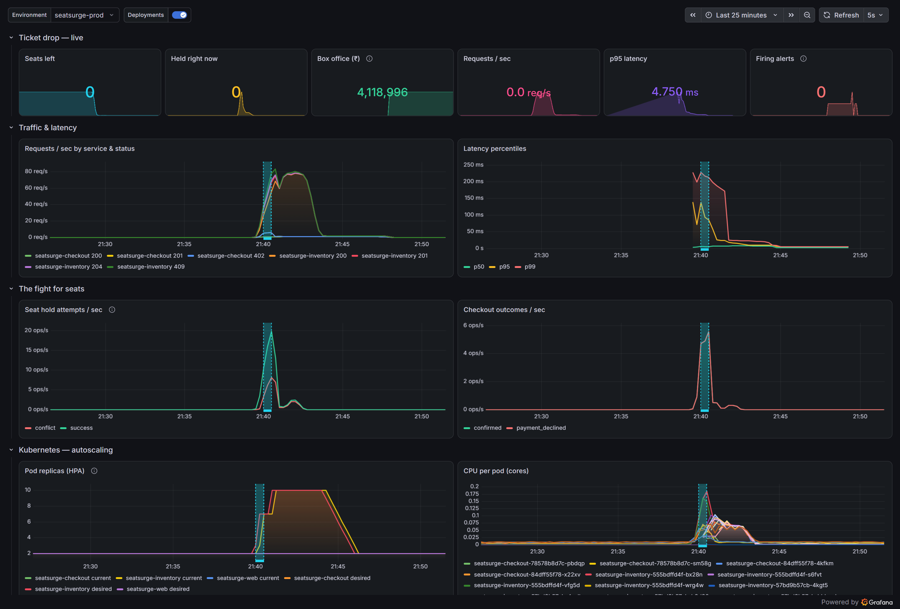
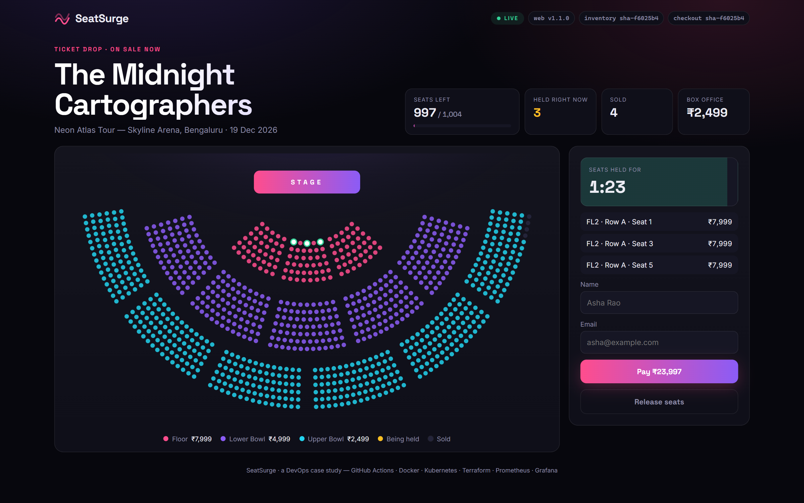
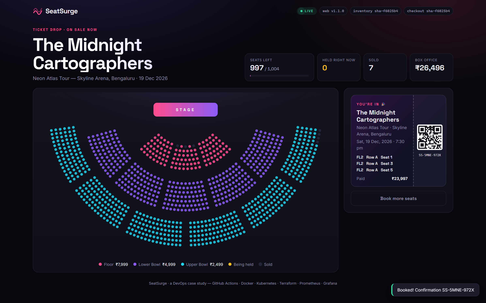

<div align="center">

# 〰️ SeatSurge

### A flash-sale concert-ticketing platform, and the DevOps pipeline that keeps it standing when 10,000 fans hit "buy" at once.

[](https://github.com/Turbo-Soggy/seatsurge/actions/workflows/ci.yml)
[](https://github.com/Turbo-Soggy/seatsurge/actions/workflows/cd.yml)
[](https://github.com/Turbo-Soggy/seatsurge/actions/workflows/codeql.yml)
[](https://github.com/Turbo-Soggy/seatsurge/actions/workflows/security.yml)

`GitHub Actions` · `Docker` · `Kubernetes` · `Helm` · `Terraform` · `Prometheus` · `Grafana` · `Loki` · `Trivy` · `CodeQL` · `Sealed Secrets` · `Azure AKS`



</div>

---

## The problem

When a popular artist's tickets go on sale, traffic jumps from almost nothing to a
stampede in seconds. Thousands of fans click the **same front-row seats** at the same moment.
The system must:

- **never sell one seat twice**, even under heavy contention
- **absorb the spike** without falling over, then shrink back afterwards to save cost
- let the team **ship fixes during the sale** without downtime
- **show what is happening** right now: traffic, latency, sold seats, errors, alerts

SeatSurge is a small but real microservice system built around that scenario, with a complete
DevOps lifecycle around it: plan → code → build → test → release → deploy → operate → monitor.

## Architecture



Seat holds are atomic Redis locks with a 90-second TTL; Postgres enforces one order per seat.
The services are stateless, so Kubernetes can scale them horizontally. Details in
[docs/architecture.md](docs/architecture.md).

## The pipeline



| Stage | What happens | Tooling |
|---|---|---|
| **Plan & collaborate** | GitFlow-lite branches, PR template, CODEOWNERS, branch protection, Conventional Commits | GitHub |
| **Build** | Multi-stage Dockerfiles: tests run *inside* the build, runtime images are distroless / unprivileged | Docker Buildx, GHA cache |
| **Test** | 46 unit tests across 3 services, coverage reports and JUnit uploaded as artifacts | pytest, vitest, Testing Library |
| **Static analysis** | Lint, type-check, Dockerfile lint, SAST | ruff, eslint/oxlint, tsc, hadolint, CodeQL |
| **Security** | Image CVEs (blocking), secrets in history, IaC misconfig, dependency CVEs, SBOM | Trivy, gitleaks, Checkov, Dependabot, Syft |
| **Artifacts** | Images (`sha-*`, `branch`, `semver`, `latest`), Helm chart `.tgz`, SBOMs, test reports, GitHub Release | GHCR, Actions artifacts |
| **Deploy** | dev → staging → **approval** → prod, `helm upgrade --atomic` auto-rolls back on failure | Helm, kind, GitHub Environments |
| **Operate** | HPA autoscaling, PodDisruptionBudgets, rolling updates, probes, graceful shutdown | Kubernetes |
| **Infrastructure** | Whole platform from `terraform apply`; Azure AKS/ACR/Key Vault module | Terraform |
| **Monitor** | Business + SLO dashboard, logs, 7 alert rules with runbook links | Prometheus, Grafana, Loki, Alloy, Alertmanager |

## Rubric alignment (24DC2006 · DevOps)

| Rubric criterion | Where it is demonstrated |
|---|---|
| **DevOps ecosystem, version control & collaboration** | [Branching strategy](docs/branching-strategy.md) · PR history · [merge-conflict case study](docs/merge-conflict-case-study.md) · `.github/` templates, CODEOWNERS, Dependabot |
| **CI/CD pipeline automation** | [`ci.yml`](.github/workflows/ci.yml) build → test → static analysis → artifacts · [`cd.yml`](.github/workflows/cd.yml) multi-stage deploy · [`release.yml`](.github/workflows/release.yml) |
| **Containerization & orchestration** | [`services/*/Dockerfile`](services) multi-stage · GHCR · [`deploy/helm/seatsurge`](deploy/helm/seatsurge): Deployments, Services, Ingress, HPA, PDB, StatefulSet, rolling updates |
| **IaC, cloud, monitoring & security** | [`infra/terraform/local`](infra/terraform/local) · [`infra/terraform/azure`](infra/terraform/azure) · [Grafana dashboard](monitoring/dashboards/seatsurge.json) · [alerts](deploy/helm/seatsurge/templates/monitoring.yaml) · [security & secrets](docs/security.md) |
| **Documentation & presentation** | This README · [`docs/`](docs) · [`report/`](report) (report + slides) · [runbook](docs/runbook.md) |

## Quick start

**Prerequisites:** Docker Desktop, kind, kubectl, Helm, Terraform, k6 (all installable with `winget`).

```bash
# 1) Just the app, with Docker Compose -> http://localhost:8080
docker compose up --build
```

```powershell
# 2) The full platform: Kubernetes + monitoring + staging & prod (≈5 min)
./scripts/up.ps1
```

| URL | What |
|---|---|
| http://seatsurge.localhost | Production |
| http://staging.seatsurge.localhost | Staging |
| http://grafana.localhost | Dashboards (anonymous read-only; admin password: `terraform -chdir=infra/terraform/local output -raw grafana_admin_password`) |
| http://prometheus.localhost · http://alertmanager.localhost | Metrics & alerts |

```powershell
# 3) The demo: 150 virtual fans storm production; watch pods autoscale in Grafana
./scripts/demo.ps1
```

```powershell
# 4) Tear it all down
./scripts/down.ps1
```

## Results

**Release v1.1.0 was rolled out to production while 150 virtual fans were buying tickets.**
The shaded band in Grafana is the rollout; traffic and checkouts peak inside it.



| Rolling update under load (k6, 150 virtual fans) | Result |
|---|---|
| Requests during the rollout window | 14,330 |
| Failed requests | **0 (0.00 %)** |
| Version probes every 0.5 s | 476 / 476 HTTP 200 while versions switched `sha-cc5532e` → `sha-f6025b4` |
| Latency avg / p95 | 14.4 ms / **23.5 ms** |
| Outcome | Sold out: 1,004 seats, ₹41,18,996, 679 collisions rejected with 409, zero double-sold |
| Autoscaling | inventory **2 → 10 pods** within ~60 s, back to 2 afterwards |
| Delivery | commit → staging verified in **5 min 39 s**; production in 83 s after approval; `helm rollback` in ~15 s |

| Hold | Ticket |
|---|---|
|  |  |

The full write-up is in [`report/SeatSurge-Report.pdf`](report/SeatSurge-Report.pdf) (also `.docx`), with
slides in [`report/SeatSurge-Slides.pptx`](report/SeatSurge-Slides.pptx).

## Repository layout

```
services/
  web/          React + Vite + TS front-end, nginx runtime
  inventory/    FastAPI seat inventory & holds (Redis)
  checkout/     Express + TS orders & payments (Postgres)
deploy/helm/seatsurge/   Helm chart + values per environment (dev, staging, prod)
infra/terraform/local/   kind cluster + full platform
infra/terraform/azure/   AKS, ACR, Key Vault, Log Analytics, VNet
monitoring/dashboards/   Grafana dashboard JSON
loadtest/                k6 "ticket drop" scenario
scripts/                 up / demo / down / seal-secret / smoke-test
docs/                    architecture, branching, security, runbook, case studies, screenshots
report/                  project report (.docx) and presentation (.pptx)
.github/                 workflows, PR/issue templates, CODEOWNERS, Dependabot
```

---

<sub>Built as the skill-based case study for **DevOps (24DC2006)**, B.Tech semester VII.
"The Midnight Cartographers" and "Skyline Arena" are fictional.</sub>
