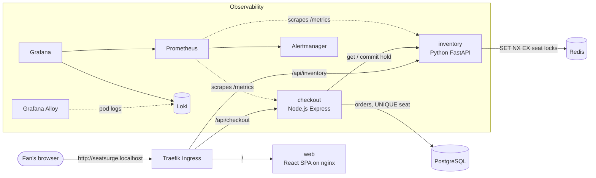
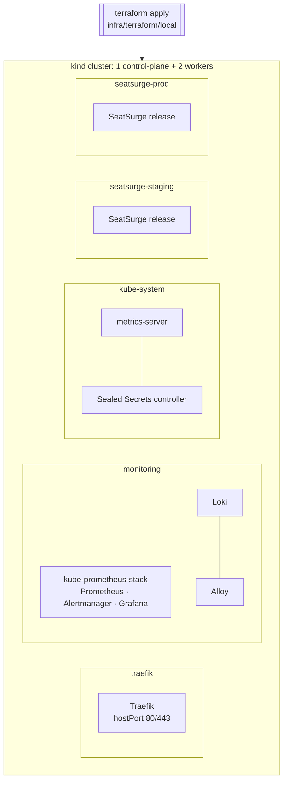

# Architecture

## Application

| Service | Language | Responsibility | Scales on |
|---|---|---|---|
| **web** | React 19 + TypeScript, served by unprivileged nginx | Seat map, hold countdown, checkout form, ticket stub, live version chips | CPU (2–4 pods) |
| **inventory** | Python 3.13, FastAPI | Venue layout, live availability, **seat holds** | CPU (2–10 pods) |
| **checkout** | Node 24, Express 5, TypeScript | Turns a hold into a paid order (mock payment gateway) | CPU (2–8 pods) |
| Redis | 7.4 | Seat locks with TTL, sold-seat set | single pod |
| PostgreSQL | 17 | Orders; `PRIMARY KEY (event_id, seat_id)` guarantees no double-selling | StatefulSet + PVC |

### How a seat is booked without double-selling

1. **Hold**: inventory runs `SET hold:<event>:<seat> <hold-id> NX EX 90` for every requested
   seat. `NX` means only the first fan wins, so a second fan gets **HTTP 409**. If any seat in a
   multi-seat request fails, the seats already grabbed are released (all-or-nothing, using a
   `WATCH`/`MULTI` compare-and-delete so we never delete someone else's lock).
2. **Pay**: checkout re-reads the hold, charges the (mock) card, then inserts the order inside a
   Postgres transaction. The composite primary key on `order_seats` is the final safety net.
3. **Commit**: checkout tells inventory to move the seats into the `sold` set. If the hold lapsed
   during payment, the order is deleted and the fan sees "you were not charged".
4. Locks that are never paid for simply **expire** after the TTL and the seats return to sale.

The services are stateless; all state lives in Redis and Postgres. That is what lets the
HorizontalPodAutoscaler add and remove pods freely during a surge.

## Platform (local, provisioned by Terraform)

Ingress is **Traefik**: the community ingress-nginx controller was retired upstream in
March 2026. Every platform chart version is pinned in `infra/terraform/local/variables.tf`.

## Cloud (Azure, `infra/terraform/azure`)

The same Helm chart targets AKS. The Azure module provisions:

- **VNet** + subnet, **AKS** with Azure CNI Overlay + Cilium network policy, Entra ID RBAC,
  workload identity, three availability zones, a system pool and an **autoscaling app pool (1–5 nodes)**
- **ACR**: AKS pulls through its kubelet managed identity (`AcrPull`), so there are no registry passwords
- **Key Vault**: holds the Postgres password; the checkout pod reads it via the CSI driver and a federated workload identity
- **Log Analytics** + Container Insights, managed Prometheus metrics

`terraform validate` runs in CI. `terraform plan` needs an Azure subscription (`az login`).
