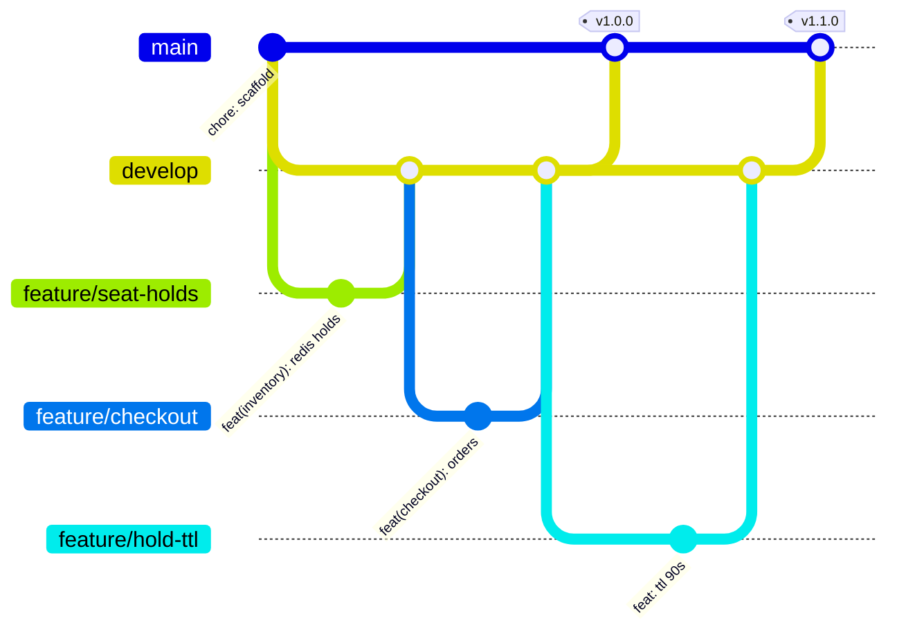

# Branching strategy & collaboration workflow

SeatSurge uses **GitFlow-lite**: two long-lived branches plus short-lived topic branches.

| Branch | Purpose | Who merges | Protection |
|---|---|---|---|
| `main` | Production. Every commit on `main` is deployed dev → staging → prod by the CD pipeline. | Release PR from `develop` (or a `hotfix/*`) | PR required, all CI checks green, no force-push or deletion |
| `develop` | Integration branch. Always deployable to staging. | Feature PRs | PR required, CI checks green |
| `feature/*` | One feature or story. Short-lived (hours to days). | n/a | none |
| `fix/*` | Non-urgent bug fix, targets `develop`. | n/a | none |
| `hotfix/*` | Urgent production fix, branched from `main`, merged to `main` **and** back to `develop`. | n/a | none |

## Pull-request workflow

1. Branch from `develop`: `git switch -c feature/<short-name> develop`.
2. Commit using **Conventional Commits** (`feat(inventory): …`, `fix(web): …`, `ci: …`, `docs: …`).
   The type drives the release notes generated on each tag.
3. Push and open a PR into `develop`. The PR template asks *what / why / how tested*.
4. CI runs automatically on the PR: lint, static analysis, unit tests, image build, Trivy scan,
   CodeQL, gitleaks, Checkov. Merging is blocked until every required check passes.
5. `CODEOWNERS` auto-requests review from the owner of the touched area.
6. Squash-merge to keep `develop` history readable; the branch is deleted automatically.
7. To release: open a PR `develop → main` titled `release: vX.Y.Z`, merge it, then tag `vX.Y.Z`.
   CD deploys to dev → staging → **waits for manual approval** → production.

## Handling merge conflicts

A worked example from this repository, two features that both changed the seat-hold
timeout, is written up in [merge-conflict-case-study.md](merge-conflict-case-study.md).

The rule of thumb we follow:

1. Update your branch with the latest target: `git fetch && git merge origin/develop`
   (or `git rebase origin/develop` for a private branch).
2. Resolve each conflicted hunk by **understanding both intents**, not by picking "ours" or "theirs".
3. Re-run the tests locally (`pytest`, `npm test`), then push. CI re-validates the merge result.
4. Explain the resolution in the PR conversation so reviewers can check it.

## Conventions

- Tags are semantic versions (`v1.1.0`). Pushing a tag builds semver-tagged images and a GitHub Release with the packaged Helm chart.
- Never commit secrets: gitleaks scans every push and PR across the full history.
- Dependabot opens weekly dependency PRs against `develop`.
