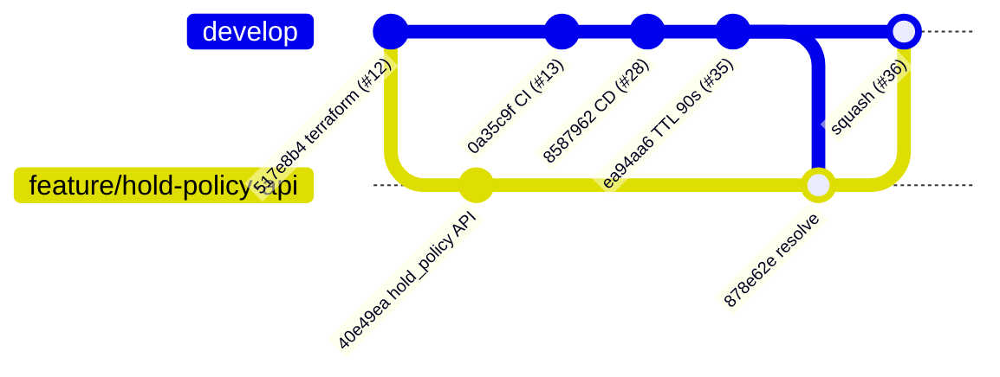

# Case study: two features, one seat-hold timeout

This is a real merge conflict from this repository's history, how it was found, and how it
was resolved. Pull requests: [#35](https://github.com/Turbo-Soggy/seatsurge/pull/35) and
[#36](https://github.com/Turbo-Soggy/seatsurge/pull/36).

## The two changes

Both branches were cut from the same `develop` commit (`517e8b4`) and worked on in parallel.

| | `feature/shorter-hold-ttl` (#35) | `feature/hold-policy-api` (#36) |
|---|---|---|
| Problem | Abandoned holds keep popular seats locked for the full 120 s | The UI hard-codes "2 minutes" and "6 seats", so a Helm change silently makes the UI wrong |
| Change | TTL default 120 → **90 s** in the service, Helm values, compose, and the UI copy | API publishes `hold_policy {ttl_seconds, max_seats}`; UI reads it |
| Lines touched | `values.yaml` `holdTtlSeconds`, `App.tsx` copy | the same `values.yaml` block, the same `App.tsx` line |

#35 passed CI and merged first. GitHub then marked #36 **"This branch has conflicts that must
be resolved"**, and branch protection blocked the merge.



## Reproducing the conflict locally

```console
$ git switch feature/hold-policy-api
$ git fetch origin
$ git merge origin/develop
Auto-merging deploy/helm/seatsurge/values.yaml
CONFLICT (content): Merge conflict in deploy/helm/seatsurge/values.yaml
Auto-merging services/web/src/App.tsx
CONFLICT (content): Merge conflict in services/web/src/App.tsx
Automatic merge failed; fix conflicts and then commit the result.
```

We **merged** `develop` into the branch instead of rebasing, because the branch was already
pushed and had an open PR with review comments. Rewriting its history would have broken those links.

### Conflict 1: `deploy/helm/seatsurge/values.yaml`

```diff
 config:
++<<<<<<< HEAD
 +  # Seat-hold policy. The web UI reads both values from GET /events/{id}, so tuning them needs no front-end change.
 +  holdTtlSeconds: 120
++=======
+   holdTtlSeconds: 90
++>>>>>>> origin/develop
    maxSeatsPerHold: 6
```

Git could not tell whether the comment added in #36 and the value changed in #35 belong together.
**Both** are wanted: the new comment and the new value.

### Conflict 2: `services/web/src/App.tsx`

```diff
++<<<<<<< HEAD
 +   Tap up to {maxSeats} seats on the map. Seats are locked to you for {formatDuration(holdTtl)} once held.
++=======
+    Tap up to {MAX_SEATS} seats on the map. Seats are locked to you for 90 seconds once held.
++>>>>>>> origin/develop
```

"Take theirs" would bring back the hard-coded copy, which is exactly the bug #36 fixes.
"Take ours" looks right, and it is right: with the API-driven copy, the UI now says
*"90 seconds"* automatically because the policy value changed. #35's intent survives without its line.

### The conflict Git did not report

After the textual conflicts were resolved, a read-through of the merged file found this line,
added by #36 and untouched by #35:

```ts
const DEFAULT_HOLD_SECONDS = 120;   // fallback used before the venue has loaded
```

It merged cleanly, but it is **semantically wrong** after #35. It was changed to `90`.
This is why the merge result gets tested and reviewed, not just compiled.

## Resolution

| File | develop (#35) | branch (#36) | Result |
|---|---|---|---|
| `values.yaml` | `holdTtlSeconds: 90` | comment + `120` | comment + **`90`** |
| `App.tsx` copy | hard-coded "90 seconds" | `{formatDuration(holdTtl)}` | API-driven copy |
| `App.tsx` fallback | n/a | `DEFAULT_HOLD_SECONDS = 120` | **`90`** (semantic fix) |

Verification before pushing the merge commit `878e62e`:

```console
$ pytest -q                                   # inventory
17 passed
$ npm run lint && npm run typecheck && npm test   # web
Tests  14 passed (14)
$ helm template t deploy/helm/seatsurge -f deploy/helm/seatsurge/values-staging.yaml | grep HOLD_TTL
  HOLD_TTL_SECONDS: "90"
```

CI then re-ran every required check on the merge result. The PR was squash-merged with
auto-merge once the checks passed, and the resolution is documented in a PR comment for the reviewer.

## What we took away

1. **Small, short-lived branches conflict less.** Both PRs were one commit and under 30 lines.
2. **Resolve by intent, not by side.** Each hunk was resolved by asking what each author wanted,
   and in one case the right answer was a third version.
3. **Look beyond the markers.** The most important fix in this merge was on a line Git never flagged.
4. **Let CI judge the merge result.** `strict` status checks on `develop` mean a PR must be
   re-tested against the latest `develop` before it can merge.
5. **Prefer configuration over duplicated constants.** After #36, the next TTL change is a
   one-line Helm change that cannot conflict with UI code.
